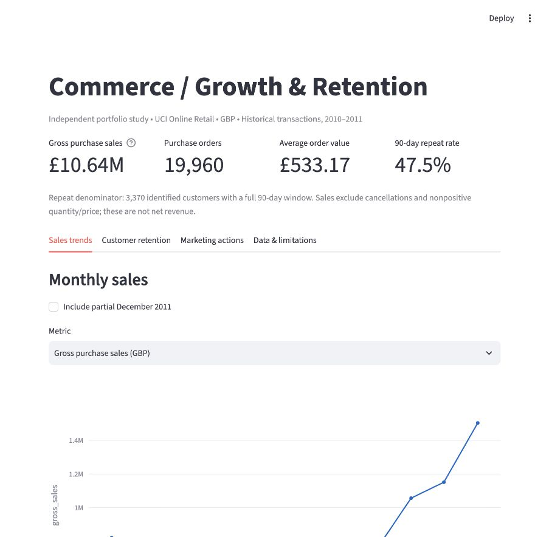
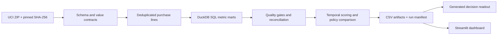

# Commerce Decision Analytics

A reproducible retail analytics workflow for a concrete decision: **when outreach capacity is limited, does a purchase-propensity model outperform a simple recency rule enough to justify an experiment?**

Built on 541,909 historical transaction lines, with SQL metric definitions, fail-closed input contracts, temporal model evaluation and an interactive decision dashboard. This is an independent, AI-assisted public-data portfolio study, not a deployed client system.



## What a reviewer can assess

| Decision / risk | Implemented evidence |
| --- | --- |
| Can sales totals be trusted? | Line → order → monthly reconciliation, invoice-grain and calendar-day checks and signed-sales bridge |
| Are repeat rates distorted by short follow-up? | Mature 90-day denominators and observed-only cohort cells |
| Is ML better than a simple rule? | April training, July/October evaluation, recency and random-selection comparisons |
| Does the answer change with contact capacity? | 5/10/20/40% policy curves and paired customer-bootstrap intervals |
| Can another analyst audit this run? | Pinned environment, source checksum, quality report and artifact/code hash manifest |
| Does this prove marketing impact? | No. A documented holdout experiment is the next decision gate |

**Historical result:** at the October 20% capacity, the model's purchase precision was 77.8% versus 62.4% for recency. This ranks natural buying propensity; it does not estimate persuasion or incremental revenue. Read the [generated findings](docs/findings.md), [decision memo](docs/decision-memo.md) and [methodology](docs/methodology.md) before interpreting the comparison.

## Architecture



The source ZIP and DuckDB cache stay local. Committed CSVs allow a reviewer to inspect the analysis without downloading raw data; they are derived public data, not client extracts.

## Business questions

1. How do purchase sales, order volume and average order value vary by month?
2. How many identified customers make another purchase within 90 days?
3. Which cohorts return, and which customer segments warrant a marketing experiment?
4. What additional instrumentation is required to measure website conversion and marketing ROI?

## Reproduce

Python 3.14 was used for validation. From this project directory:

```sh
python3 -m venv .venv
source .venv/bin/activate
pip install -r requirements.txt
python src/pipeline.py
python -m pytest -q
python src/verify.py
streamlit run app.py
```

The pipeline downloads the original UCI ZIP (approximately 23 MB), caches it locally, computes a SHA-256 checksum, runs SQL in DuckDB and exports CSV/JSON outputs. Raw data and local environment are excluded from Git. To refresh, delete `data/raw/online-retail.zip` and rerun. A different upstream checksum stops the pipeline before parsing; the expected checksum is pinned in `src/contracts.py`. Review provenance before changing it. No credentials are required.

## Validation and operation

GitHub Actions runs the test suite and manifest verification on pushes and pull requests. A manual workflow option additionally downloads and rebuilds the original dataset. The tests cover temporal boundaries, cohort censoring, reconciliation, paired-policy equivalence, malformed input rejection and dashboard interactions. The full rebuild applies quality gates to the actual dataset.

`python src/verify.py` checks that source analysis code and derived CSV/JSON files match the successful run manifest. The timestamp identifies the computation time; bootstrap draws use a fixed seed. SQL row ordering and floating-point reductions can differ across runs; the manifest verifies one exact run, while reconciliations use explicit numeric tolerances. The run timestamp changes. Inspect `outputs/quality_report.json` for named checks. Input/check failures stop execution; a failed run may leave partial files, so rebuild successfully and verify before using outputs. A current successful manifest is required for release.

## Deliverables

- `src/pipeline.py`: download, exact-duplicate removal, purchase filtering, audit and reconciliation.
- `sql/metrics.sql` and `sql/advanced.sql`: order grain, monthly KPIs, 90-day repeat, cohort retention, behavioral segments and signed-sales reconciliation.
- `src/contracts.py`: source identity/schema contracts and named aggregate quality gates.
- `src/decision.py`: capacity-sensitive paired policy comparison with fixed-seed bootstrap uncertainty.
- `src/verify.py`: verify run provenance and detect stale or modified artifacts.
- `src/advanced.py`: basket mining, time-separated repurchase modeling, calibration and baseline evaluation.
- `app.py`: interactive Streamlit dashboard with Plotly charts and data quality disclosure.
- `outputs/`: reproducible aggregates and source checksum; customer-level exports are pseudonymous original public IDs, not personal contact details.
- `docs/findings.md`: calculated findings, interpretation and proposed actions.
- `docs/measurement-plan.md`: conversion, CAC, ROAS and experiment measurement requirements.
- `tests/test_analysis.py`: synthetic edge cases for cleaning, right censoring, zero-retention months and dashboard interactions.

## Metric contract and limitations

**Purchase sales** sum quantity × unit price for positive quantity/price rows with invoice IDs not beginning with C. Exact duplicate rows are removed (assumption: duplicates are ingestion duplication; identical legitimate lines could be lost). Sales are gross purchase value in GBP, not net revenue, margin or profit. Non-merchandise stock codes are not removed, so invoice charges may be included.

**Orders** group invoice and customer ID. Reconciliation checks the dataset has one customer grouping per invoice. Missing customer IDs remain in sales but are excluded from customer analytics. AOV = purchase sales / purchase orders.

**90-day repeat rate** uses identified customers whose first observed purchase has a full 90-day follow-up before the last recorded calendar date. Numerator requires another order at a later timestamp within 90 days; same-timestamp orders do not count. First observed purchase is not verified first lifetime purchase. Cancellations are not linked back to original purchases; later returns do not remove a purchase from repeat analysis.

**Cohort retention** = customers purchasing in month N / customers in the first observed purchase month. The incomplete final month is excluded; observed months with no activity are zero, future months are blank. Cohort 0 is 100% by construction.

**Segments** use transparent illustrative thresholds (90-day recency; three orders for repeat segments). They are rules, not trained or validated predictive scores. Negative-quantity value in the audit is a diagnostic, not a matched refund accounting measure.

The source spans December 2010 to December 2011; December 2011 is partial. No current-market forecast or causal marketing result is claimed. Many customers are wholesalers, limiting generalization to modern consumer e-commerce. No traffic, ad spend or attribution data exists, so visitor conversion, CAC and ROAS are unavailable.

## Data provenance and license

Source: [UCI Online Retail](https://archive.ics.uci.edu/dataset/352/online+retail), Daqing Chen (2015), DOI [10.24432/C5BW33](https://doi.org/10.24432/C5BW33). Licensed [CC BY 4.0](https://creativecommons.org/licenses/by/4.0/). Original historical transactions cover a UK non-store retailer, December 1, 2010–December 9, 2011. This project modifies the source through deduplication, filtering and aggregation. Attribution applies to the source data and derived extracts. No affiliation with the retailer or UCI is implied.

## GitHub publication

Published as an independent portfolio project at https://github.com/harryli1998/ecommerce-growth-analytics with real commit timestamps. No client, work-hour, earlier employment or prior project history is asserted. The Streamlit dashboard runs locally using the instructions above; GitHub hosts the source and preview image.
