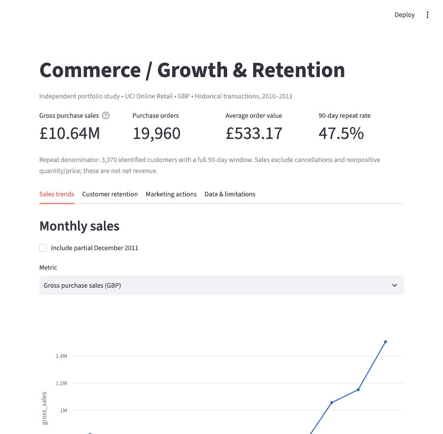

# E-commerce Growth & Marketing Analytics

An independent portfolio project started October 24, 2026. Built with AI assistance; the owner should review and understand the methods before presenting it. This is a new public-data analysis, not client work, employment history or evidence of work performed in earlier months.



## Business questions

1. How do purchase sales, order volume and average order value vary by month?
2. How many identified customers make another purchase within 90 days?
3. Which cohorts return, and which customer segments warrant a marketing experiment?
4. What additional instrumentation is required to measure website conversion and marketing ROI?

## Reproduce

Python 3.14 was used for validation. From this project directory:

```sh
python3 -m venv .venv
source .venv/bin/activate
pip install -r requirements.txt
python src/pipeline.py
pytest -q
streamlit run app.py
```

The pipeline downloads the original UCI ZIP (approximately 23 MB), caches it locally, computes a SHA-256 checksum, runs SQL in DuckDB and exports CSV/JSON outputs. Raw data and local environment are excluded from Git. To refresh, delete `data/raw/online-retail.zip` and rerun. A different upstream checksum requires review; the validated checksum is in `outputs/summary.json`. No credentials are required.

## Deliverables

- `src/pipeline.py`: download, exact-duplicate removal, purchase filtering, audit and reconciliation.
- `sql/metrics.sql`: order grain, monthly KPIs, 90-day repeat, cohort retention and behavioral segments.
- `app.py`: interactive Streamlit dashboard with Plotly charts and data quality disclosure.
- `outputs/`: reproducible aggregates and source checksum; customer-level exports are pseudonymous original public IDs, not personal contact details.
- `docs/findings.md`: calculated findings, interpretation and proposed actions.
- `docs/measurement-plan.md`: conversion, CAC, ROAS and experiment measurement requirements.
- `tests/test_analysis.py`: synthetic edge cases for cleaning, right censoring, zero-retention months and dashboard interactions.

## Metric contract and limitations

**Purchase sales** sum quantity × unit price for positive quantity/price rows with invoice IDs not beginning with C. Exact duplicate rows are removed (assumption: duplicates are ingestion duplication; identical legitimate lines could be lost). Sales are gross purchase value in GBP, not net revenue, margin or profit. Non-merchandise stock codes are not removed, so invoice charges may be included.

**Orders** group invoice and customer ID. Reconciliation checks the dataset has one customer grouping per invoice. Missing customer IDs remain in sales but are excluded from customer analytics. AOV = purchase sales / purchase orders.

**90-day repeat rate** uses identified customers whose first observed purchase has a full 90-day follow-up before the last recorded calendar date. Numerator requires another order at a later timestamp within 90 days; same-timestamp orders do not count. First observed purchase is not verified first lifetime purchase. Cancellations are not linked back to original purchases; later returns do not remove a purchase from repeat analysis.

**Cohort retention** = customers purchasing in month N / customers in the first observed purchase month. The incomplete final month is excluded; observed months with no activity are zero, future months are blank. Cohort 0 is 100% by construction.

**Segments** use transparent illustrative thresholds (90-day recency; three orders for repeat segments). They are rules, not trained or validated predictive scores. Negative-quantity value in the audit is a diagnostic, not a matched refund accounting measure.

The source spans December 2010 to December 2011; December 2011 is partial. No current-market forecast or causal marketing result is claimed. Many customers are wholesalers, limiting generalization to modern consumer e-commerce. No traffic, ad spend or attribution data exists, so visitor conversion, CAC and ROAS are unavailable.

## Data provenance and license

Source: [UCI Online Retail](https://archive.ics.uci.edu/dataset/352/online+retail), Daqing Chen (2015), DOI [10.24432/C5BW33](https://doi.org/10.24432/C5BW33). Licensed [CC BY 4.0](https://creativecommons.org/licenses/by/4.0/). Original historical transactions cover a UK non-store retailer, December 1, 2010–December 9, 2011. This project modifies the source through deduplication, filtering and aggregation. Attribution applies to the source data and derived extracts. No affiliation with the retailer or UCI is implied.

## GitHub publication

Prepared locally. Review the outputs and publish under your own GitHub account when access is available. Do not add tokens to files. Use real commit timestamps and describe this as an independent portfolio project. No client, work-hour, earlier employment or prior project history is asserted.
